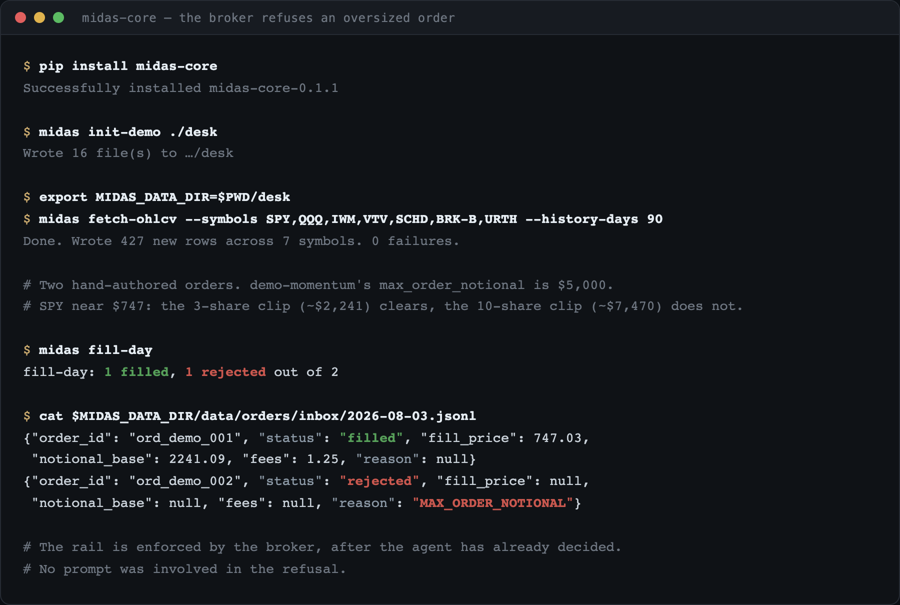
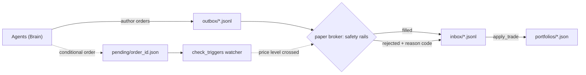

# midas-core

**An open, multi-agent paper-trading fund-manager framework built on a Brain/Hands split:
agents author decisions; a broker enforces the safety rails and executes them.** This repo
is the reusable core — the engine, the config-driven roster/allocator model, a runnable demo
desk, and the deterministic Hands pipeline. Bring your own agents.

[](https://github.com/w2ur/midas-core/actions/workflows/tests.yml)
[](https://pypi.org/project/midas-core/)
[](./LICENSE)
[](https://www.python.org/downloads/)



*The whole thesis in one command. Two orders, same agent, same instant: the broker fills the
3-share clip and refuses the 10-share one against a `$5,000` notional cap it enforces itself.
Reproduce it with the [quickstart](#quickstart--reach-a-real-fill) below — nothing above is mocked.*

> **Paper-trading by default.** This is a framework, not a service: it never executes against
> your broker keys, never pools funds, never gives per-user advice. See [DISCLAIMER.md](./DISCLAIMER.md).

## Why this exists

- **Safety lives in the broker, not the prompt.** The persona is aspirational; the broker is
  enforcing. Every order is checked at fill time against the fixed set of rejection/cancel
  reason codes in [`REJECTION_REASON_CODES`](engine/paper_broker.py) — `MAX_ORDER_NOTIONAL`,
  `MAX_ORDERS_PER_DAY`, `TICKER_NOT_IN_UNIVERSE`, `INSUFFICIENT_CASH`, `DAILY_DRAWDOWN_HALT`,
  … — so a coaxed or confused agent still can't slip an oversized trade through. The universe
  rail (`TICKER_NOT_IN_UNIVERSE`) applies only when a desk sets `allowed_universe` in its
  roster; every roster shipped here, the demo desk included, leaves it empty and so allows any
  ticker.
- **Reproducible by construction.** Dependencies are a fully-pinned lockfile; prices, index
  universes and orders are committed to git, and the daily fill path never touches the
  network (only the conditional-order watcher reads live crypto prices, to decide when a
  trigger fires). Agents may run a capped number of web searches while they decide (three per trader);
  those run on the model's side and are recorded as self-reported provenance, not as an input
  you can replay. Every fill is
  stamped with `executed_sha`, the git HEAD it executed against — `git checkout <sha>` re-derives
  the exact order and price store the broker saw.
- **Proven on a live desk, and you can read the whole ledger.** A 10-agent desk has run this
  engine every weekday since 2026-04-17, narrated at [midas.revah.paris](https://midas.revah.paris)
  and published in full at [`w2ur/midas`](https://github.com/w2ur/midas) — every order, fill,
  snapshot, journal and price bar it has ever seen, in its commit history. This repo is a one-way
  code mirror of that desk's engine; the desk itself is the evidence the engine runs.
- **Conditional orders, not just market orders.** Agents can defer a trade until a price level
  is crossed. Expiry is mandatory; a separate watcher process fires the order when the condition
  is met and applies the same order-level rails as a market fill.

## Architecture — Brain / Hands

The **Brain** (agents) only ever writes to disk; it holds no credentials. The **Hands** (the
paper broker, a separate watcher process) reads that outbox, enforces the rails, and executes.
The boundary is a directory of append-only JSONL files, so a real-money broker is a drop-in swap
for the paper one behind the same contract.



## Quickstart — reach a real fill

This drives the full loop end-to-end: bootstrap prices, hand-author two orders (one clears, one
is deliberately oversized to trip a rail), run the broker, and inspect the fills.

```bash
python -m venv .venv && source .venv/bin/activate
pip install midas-core

# Materialise the packaged demo desk (roster.yaml, .claude/agents/demo-*.md,
# data/universes/*.json) into a directory you name — no git clone required.
midas init-demo ./my-desk
export MIDAS_DATA_DIR=$PWD/my-desk

# One-time: open a USD 10,000 portfolio for demo-momentum.
python -c "
from engine.config import get_config
from engine.portfolio import PortfolioManager
pm = PortfolioManager(base_dir=get_config().portfolios_dir)
pm.initialize('demo-momentum', initial_capital=10000, currency='USD')
"

# Bootstrap the price store from yfinance (the one networked step; the live desk
# populates this store from a cron so the fill path stays HTTP-free).
midas fetch-ohlcv --symbols SPY,QQQ,IWM,VTV,SCHD,BRK-B,URTH --history-days 90
```

Author two orders — append-only JSONL, one per line — to
`$MIDAS_DATA_DIR/data/orders/outbox/<TODAY>.jsonl` (`<TODAY>` = today's `YYYY-MM-DD`). Every
field is required, including a non-empty `reasoning` (no silent trades); `shares` must be
strictly positive (Midas is long-only):

```jsonl
{"order_id": "ord_demo_001", "ts": "2026-04-17T20:00:00Z", "agent_id": "demo-momentum", "action": "BUY", "ticker": "SPY", "shares": 3, "reasoning": "Trend intact above the 50-day; adding core exposure.", "currency": "USD"}
{"order_id": "ord_demo_002", "ts": "2026-04-17T20:00:00Z", "agent_id": "demo-momentum", "action": "BUY", "ticker": "SPY", "shares": 10, "reasoning": "Deliberately oversized clip to demonstrate the notional rail.", "currency": "USD"}
```

`demo-momentum`'s `max_order_notional` is `5000`. With SPY near $760 the first order (~$2,280)
clears; the second (~$7,600) breaches the cap. Run the broker:

```bash
midas fill-day
# fill-day: 1 filled, 1 rejected out of 2
```

The inbox is the durable Hands-side record of both outcomes:

```bash
cat $MIDAS_DATA_DIR/data/orders/inbox/<TODAY>.jsonl
```

```jsonl
{"order_id": "ord_demo_001", "ts_filled": "2026-10-26T17:48:51.025216Z", "status": "filled", "fill_price": 759.969970703125, "fill_currency": "USD", "notional_base": 2279.909912109375, "fees": 1.25, "reason": null}
{"order_id": "ord_demo_002", "ts_filled": "2026-10-26T17:48:51.026092Z", "status": "rejected", "fill_price": null, "fill_currency": null, "notional_base": null, "fees": null, "reason": "MAX_ORDER_NOTIONAL"}
```

The filled order mutated `data/portfolios/demo-momentum/portfolio.json` (cash debited, a SPY
position opened); the rejected one changed nothing but its reason. Exact prices and timestamps depend
on the day you fetch — the shape (one fill, one rejection, a debited portfolio) is the point. Outside a
git checkout the `executed_sha` stamp is omitted, as above.

The full walkthrough — the portfolio JSON, the `executed_sha` provenance stamp, and the roster
schema — is in [`./examples/demo-desk/README.md`](./examples/demo-desk/README.md).

### From source (contributors)

```bash
python -m venv .venv && source .venv/bin/activate
pip install -r requirements.txt   # pinned lockfile (incl. pytest + hypothesis)
pip install -e .                  # the midas-core package + the `midas` CLI

pytest -q
```

A bare `pytest` works from a fresh checkout: when `MIDAS_DATA_DIR` is unset and the tree has no
desk of its own, `tests/conftest.py` points it at `examples/demo-desk` (CI sets the same value
explicitly). To run against a different desk, export the variable yourself; an explicit value is
never overridden:

```bash
cp -R examples/demo-desk /tmp/my-desk
MIDAS_DATA_DIR=/tmp/my-desk pytest -q
```

The suite runs with **warnings as errors** (`filterwarnings` in `pyproject.toml`). Three
third-party warnings are named as exceptions with their justification; anything else fails
the run. That is a hard gate rather than a fragile one only because `requirements.txt` is a
fully-resolved lockfile — a new upstream warning can reach you only through a deliberate
lock bump.

## Run your own desk

The whole cast is config. Copy the demo desk and edit two things:

1. **`roster.yaml`** — declare your traders, a `narrator`, and an optional `allocator`, each with
   its universe, starting capital, and **broker-enforced** `safety` rails (`max_order_notional`,
   `max_orders_per_day`, `daily_drawdown_halt_pct`, `allowed_universe`; an empty
   `allowed_universe` means no universe restriction).
2. **`.claude/agents/*.md`** — the persona behind each id: its voice and its strategy.

Nothing else is hardcoded. The full roster schema (every field and its default) is documented in
[`./examples/demo-desk/README.md`](./examples/demo-desk/README.md).

### The driver mints the identities

The paper broker reads orders and cancels from files an agent can write, and it trusts three
identities in them only as far as a shape check: `agent_id`, `order_id` and a cancel's
`request_id`. It requires the minted alphabet (letters, digits, `_` and `-`, so none can name a
path), keeps `cnl_*` request ids and order ids in disjoint namespaces, and refuses anything else
with `INVALID_AGENT_ID`, `INVALID_ORDER_ID` or `INVALID_REQUEST_ID`. A cancel is accepted only
under the exact request id the driver mints for its agent and day,
`cnl_{date}_{agent_id}_{seq:03d}`, so one agent cannot take another's id. A refused row is filed
under an id derived from the line, never under the id it claimed.

It does **not** prove that an `agent_id` belongs to the agent that wrote the line, nor that an
`order_id` was minted for that agent: an `agent_id` outside the roster still gets the default
safety rails, and a line can still carry another agent's well-formed id. Your driver must mint
all three itself (`scripts/daily_session.py` does: `agent_id` from the roster, ids from
`make_order_id` and `cnl_{date}_{agent}_{seq}`) and must never copy one out of agent output.
A driver that lets an agent choose its own ids hands it the ability to act as another agent.

## What you need

| To run…                                                        | Requirements                                   |
| -------------------------------------------------------------- | ---------------------------------------------- |
| **Deterministic pipeline** — fills, baselines, backtests       | Python 3.12, 3.13 or 3.14. No API keys, no accounts. |
| **LLM trading sessions** — personas, journals, narration       | Runs under [Claude Code](https://claude.com/claude-code) (`scripts/daily_session.py`). |

The deterministic pipeline is headless and fully tested; you can drive a desk end-to-end with no
model at all by hand-authoring orders, exactly as the quickstart does.

## Honest framing

- **Paper-trading by default.** Fills are simulated against a committed price store. No output is
  a track record, evidence of an edge, or investment advice.
- **Framework, not a service.** midas-core never executes against your broker keys, never holds
  credentials, never pools or manages anyone's funds, and gives no per-user advice. A real-money
  broker would be *your* code, swapped in behind the same outbox/inbox contract.
- Full terms: [DISCLAIMER.md](./DISCLAIMER.md).

## Relationship to the live desk

This repository is a **one-way code mirror**, synced from the live desk repo
[`w2ur/midas`](https://github.com/w2ur/midas) (the source of truth) by a manifest tool. That repo
went public on 2026-08-21, so the split is no longer a privacy boundary — it is a **packaging**
one. `midas-core` is the installable framework, versioned and published to PyPI; `w2ur/midas` is
one desk that runs on it, carrying a data ledger (real portfolios, journals, daily narrative) that
is deliberately **not** mirrored here. The bundled `examples/demo-desk` is a synthetic fixture, so
this stays a clean framework rather than one desk's history. Because of the mirror direction, code
PRs against synced trees can't be merged — please open an issue instead. See
[CONTRIBUTING.md](./CONTRIBUTING.md).

## Layout

- `engine/` — types, market data, bt adapter, paper broker, config (`roster.yaml` loader), universes.
- `scripts/` — session orchestration (`daily_session.py`), the conditional-order watcher
  (`check_triggers.py`), backtest runners, universe refresh.
- `examples/demo-desk/` — the forkable reference desk.
- `data/{strategies,universes}/` — generic strategy specs + index constituents.

## License

[MIT](./LICENSE).
